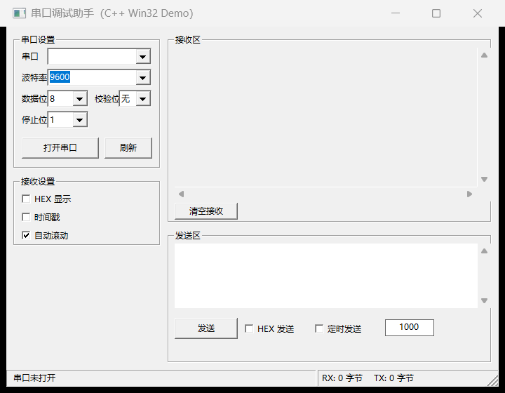

# 串口调试助手（C++ Win32 上位机 Demo）


一个纯 **Win32 API** 编写的串口调试助手上位机程序，无任何第三方依赖，仅需 MinGW (g++) 即可编译。作为 C++ 项目 Demo，展示 Windows 桌面开发、串口通信与多线程编程能力。

## 功能特性

- **串口管理**：自动枚举系统可用串口（读取注册表），支持手动刷新；波特率 2400 ~ 921600 可配置（也可手动输入），数据位 / 校验位 / 停止位可选
- **数据接收**：独立读线程阻塞接收 + `PostMessage` 安全投递回 UI 线程，支持 **HEX 显示**、**时间戳**、**自动滚动**
- **数据发送**：文本或 **HEX 模式**发送（支持 `01 02 0x3F` 写法），支持**定时发送**（间隔可配，毫秒级）
- **收发统计**：状态栏实时显示连接状态与累计 RX / TX 字节数
- **细节处理**：收发缓冲区扩容、读超时设计保证线程干净退出、接收区字符上限防内存膨胀、微软雅黑统一字体、高分屏 DPI 适配

## 技术要点

| 模块 | 说明 |
| --- | --- |
| 串口枚举 | 注册表 `HKEY_LOCAL_MACHINE\HARDWARE\DEVICEMAP\SERIALCOMM` |
| 串口打开 | `CreateFile("\\.\COMx")` + `DCB` 参数配置 + `COMMTIMEOUTS` 超时控制 |
| 接收线程 | 阻塞 `ReadFile` + `std::atomic<bool>` 退出标志 + 100ms 读超时，避免线程无法结束 |
| 线程通信 | 堆上拷贝数据 → `PostMessage(WM_USER + 100)` → UI 线程处理并释放 |
| 界面 | 纯 Win32 控件（组合框 / 分组框 / 状态栏），`WM_SIZE` 自适应布局 |

## 编译运行

### 本地构建（Windows + MinGW）

```bash
g++ -std=c++17 -municode -mwindows -O2 -static \
    src/main.cpp src/serial_port.cpp \
    -o SerialPortAssistant.exe \
    -lcomctl32 -ladvapi32
```

> `-static` 静态链接 MinGW 运行库：生成的 exe 自包含，不依赖任何 libstdc++/libgcc DLL，任意 Windows 机器可直接运行。

或使用 VS Code：打开项目后按 `Ctrl+Shift+B`（已配置 tasks.json）。

> 也可从本仓库 Actions 的 [Build 工作流](https://github.com/liuyan2335/SerialPortAssistant/actions) 下载已编译好的 exe（构建产物 artifact）。

### 使用说明

1. 连接 USB 转串口设备（如 CH340、CP2102），打开软件
2. 选择串口与参数（默认 9600-8-N-1），点击「打开串口」
3. 接收区自动显示数据；发送区输入内容后点击「发送」，或勾选「HEX 发送」以十六进制发送
4. 没有硬件时，可用虚拟串口对（如 com0com）自发自收验证

## 项目结构

```
C++demo/
├── src/
│   ├── main.cpp         # 主窗口、UI 布局、收发逻辑、读线程
│   ├── serial_port.h    # 串口通信封装声明
│   ├── serial_port.cpp  # 串口枚举 / 打开 / 写入实现
│   └── resource.h       # 控件 ID 与自定义消息定义
├── .vscode/tasks.json   # VS Code 构建任务（Ctrl+Shift+B）
├── .github/workflows/   # GitHub Actions 自动编译
└── README.md
```

## 界面截图



## 开发环境

- 语言：C++17
- 编译器：MinGW-w64 g++ 8.1.0（GCC 任意较新版本均可）
- IDE：VS Code
- 平台：Windows
